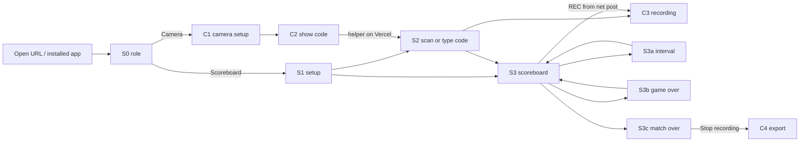
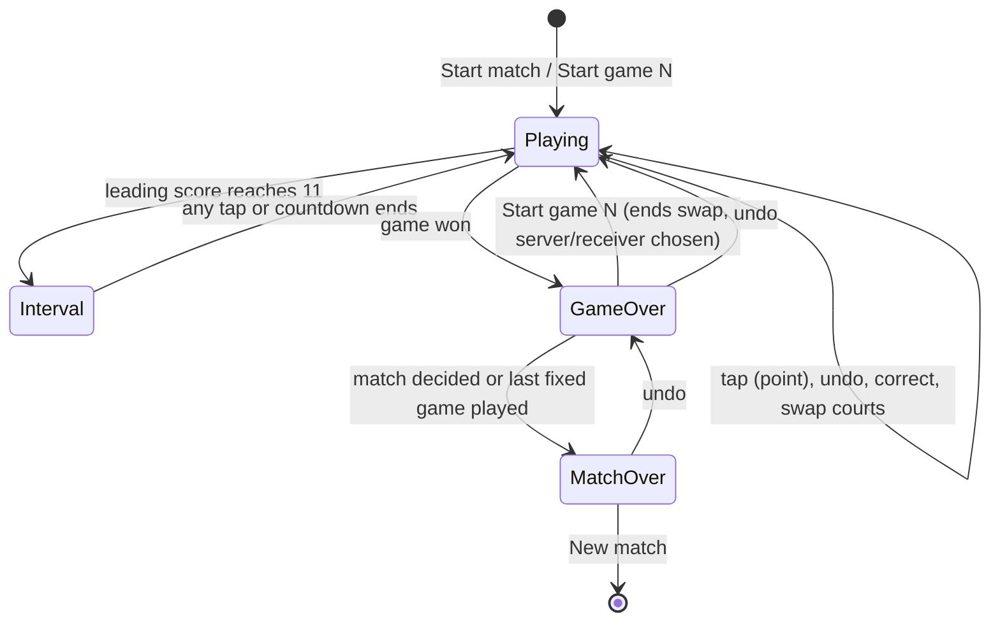

# UX design

How the two iPhones are used on the court. Requirement ids refer to
[requirements.md](requirements.md); the decisions D1 to D13 recorded there are
assumed. A rough tappable version of the main screens is in
[mockup/index.html](mockup/index.html) (§6).

Both roles run in landscape. Dark background, big type, team colours. Every
screen is designed to be understood by a sweaty player who has never seen the
app, from 6 m away or with one glance at the net post.

## 1. Screen inventory

| Id | Role | Screen | Requirements |
|---|---|---|---|
| S0 | both | Role choice | R-SETUP-1 |
| S1 | scoreboard | Match setup | R-SETUP-2, R-SETUP-3 |
| S2 | scoreboard | Pairing: scan or type the code | R-PAIR-1 |
| S3 | scoreboard | Scoreboard | R-SCORE-*, R-DISP-* |
| S3a | scoreboard | Interval overlay | R-SCORE-4, R-SCORE-5 |
| S3b | scoreboard | Game over / change ends overlay | R-SCORE-2, R-SCORE-3, R-SCORE-5 |
| S3c | scoreboard | Match over overlay | R-SCORE-2 |
| S3d | scoreboard | Why was this point won (popup) | R-TAG-2, R-TAG-3 |
| S3e | scoreboard | Rally list (tag later) | R-TAG-4 |
| S3v | scoreboard | Scoring a saved video: the board with a player (D17) | R-VID-2 to R-VID-4 |
| S3v-r | scoreboard | Open the video again after a reload | R-VID-5 |
| S4 | scoreboard | Correction sheet | R-SCORE-7 |
| S5 | scoreboard | Menu | R-SCORE-7, R-PAIR-6 |
| C1 | camera | Camera setup | R-SETUP-4, R-REC-3, R-REC-4 |
| C2 | camera | Pairing: show the code | R-PAIR-1 |
| C3 | camera | Recording | R-REC-*, R-DISP-9 |
| C4 | camera | Recordings and export | R-REC-6, R-EXP-* |
| E1 | both | Error, offline and reconnect states | R-REC-5, R-DISP-9, R-PAIR-8, N-BROWSER-1 |

### S0 Role choice

```
+---------------------------------------------------------------+
|                    badminton-scoreboard                       |
|                                                               |
|  +---------------+   +---------------+   +---------------+    |
|  |  SCOREBOARD   |   |    CAMERA     |   |     VIDEO     |    |
|  |at the net post|   | at the back   |   | score a saved |    |
|  |               |   |    corner     |   |     video     |    |
|  +---------------+   +---------------+   +---------------+    |
|                                                               |
|   Last time: Scoreboard                     Recordings (2) >  |
+---------------------------------------------------------------+
```

Three cards side by side (stacked in portrait). The previous role is
highlighted. The "Recordings" link opens C4 on any phone that holds
recordings. VIDEO (D17, R-VID-1) opens the file picker from its own tap
(Photo Library or Files on the iPhone, the file picker on a Mac); a picked
file goes to S1, whose title names it and which has no pairing chip. Picking
does not change the remembered role. On a computer the browser note adds that
scoring a saved video works there too.

### S1 Match setup (scoreboard)

```
+---------------------------------------------------------------+
| <  Match setup                              [ Same as last ]  |
|   LEFT of this screen              RIGHT of this screen       |
|   Team     [ A         ]           Team     [ B         ]     |
|   Colour   (o)(o)(o)(o)            Colour   (o)(o)(o)(o)      |
|   Player 1 [ Nok       ]           Player 1 [ Bank      ]     |
|   Player 2 [ Pae       ]           Player 2 [ Tao       ]     |
|   Starts right court (P1*)(P2)     Starts right court (P1*)(P2)|
|                                                               |
|   Players (Singles)(Doubles*)   Points (11)(15)(21*)          |
|   Format (Best of 3*)(Fixed 2)(Fixed 1)   Interval at 11 (on*)|
|   First server (Left team*)(Right team)      [ START MATCH ]  |
|   Point reasons (Off)(End of game*)                           |
+---------------------------------------------------------------+
```

- "Left" and "right" are literal: the side of this screen as it will sit on
  the post. No court geometry questions.
- Doubles adds two names per team and one question per team: who starts in
  the right service court (R-SETUP-2, D4). That is all the engine needs; the
  serving team's right-court player serves first, the other team's right-court
  player receives (R-SCORE-3).
- Formats per D12. A one-line hint explains fixed 2 ("two games always, 1-1 is
  a draw").
- "Same as last" fills everything from the previous match and starts. Fresh
  install: singles, A and B, first two palette colours, 21, best of 3,
  interval on, A serves (R-SETUP-3).
- Pairing is reachable from S1 and from the menu, so the scoreboard works
  alone (R-PAIR-3).

### S2 / C2 Pairing (one code, D2)

```
 Camera phone (C2)                      Scoreboard phone (S2)
+------------------------------+       +------------------------------+
| Pair with the scoreboard     |       | Pair with the camera         |
|                              |       |                              |
|        [ QR code ]           |  -->  |      [ viewfinder ]          |
|        4 8 2 1 0 7           |       |   or type the code           |
|                              |       |   [4][8][2][1][0][7]  (ok)   |
| waiting for the scoreboard.. |       |                              |
|                              |       | Paired, camera ready  (ok)   |
| Paired with "A vs B"  (ok)   |       | link: paired  REC: idle      |
+------------------------------+       +------------------------------+
```

- The camera phone publishes its connection offer through the helper and shows
  a QR code plus the six-digit room code. The scoreboard phone scans it, or
  the user types the digits if scanning is awkward (R-PAIR-1).
- The viewfinder stays open behind the keypad even when typing: on iPhone the
  camera permission is also what lets the browser offer local-network
  connection candidates (technical-design.md §4).
- Needs internet on both phones for about ten seconds; afterwards the phones
  talk directly over the Wi-Fi or hotspot. With no internet the screen says
  "No internet: cannot pair. Scoring and recording still work on each phone."
  (E1).
- Reconnection after a drop is automatic and silent (R-PAIR-8); no screen.
- **A second scoreboard (D14).** Once the first scoreboard is linked, C2 lists
  it ("Scoreboard 1: iPhone · 7c2f", its chip, Unpair) and shows a fresh code
  for a second one; Done closes it (an unused code is withdrawn), and it
  closes by itself once two are linked. The camera menu offers "Pair another
  scoreboard…" at any time, mid-match and while recording too; C1 says "A
  second scoreboard can join at any time". The second scoreboard pairs
  exactly like the first and then shows the camera's match, whatever it showed
  before. Both scoreboards work the same.

### S3 Scoreboard (main screen)

```
+---------------------------------------------------------------+
| ...   Game 2 - A 1-0 B                (*) REC 12:34   link ok |
|                               .                               |
|            A                  .              B                |
|                               .                               |
|          20  >                .             16                |
|                               .                               |
|      GAME POINT               .                               |
|   +---------------+           .        +---------------+      |
|   | L  Pae        |           .        | R  Bank       |      |
|   | R  Nok  >     |           .        | L  Tao   recv |      |
|   +---------------+           .        +---------------+      |
|                      ( <- Undo )                              |
+---------------------------------------------------------------+
   tap anywhere on the left half     tap anywhere on the right half
```

- Left half scores for the team currently on the left of the screen; right
  half for the other (R-DISP-1). The halves carry a dim team-colour tint; the
  digits are in full team colour (R-DISP-2).
- `>` is the shuttle (server) marker. Under the digits each half shows its
  team's two service courts as two cells with the player names: the serving
  player's cell carries the shuttle, the receiver's cell says "recv"
  (R-DISP-4, D4). The **bottom cell is the service court nearest the
  scoreboard phone**: for the team on the left of the screen that is their
  right court; for the team on the right it is their left court. This holds
  whichever post the phone sits on, as long as the screen faces along the net.
  Singles shows one line, "serves from right".
- "GAME POINT" / "MATCH POINT" sit under the digits of the team that has it
  (R-DISP-5).
- Top bar: menu (`...`), game number, games and format, camera REC state and
  elapsed time, link chip (R-DISP-9), and "+1 scoreboard" when another
  scoreboard is linked to the same camera (D14). The chip says "syncing…"
  until the camera's match has arrived after a (re)connect, and while the
  link is down "reconnecting · 12 s" (seconds since the camera last sent its
  state), so a score shown then is never taken for a live one. It is 56 px
  tall and not part of the tap zones.
- Paired, a tap the camera had already counted from the other scoreboard (the
  same rally within 1.5 s) shows "Already counted on the other scoreboard" at
  the top for 1.5 s and is not announced.
- When the screen cannot be kept on (Low Power Mode, an old iOS) one amber line
  at the bottom says so (R-DISP-8).
- Undo pill at bottom centre, 160 × 56 px, in a 72 px band that is not part
  of the tap zones (D6, R-SCORE-6). After an undo it reads "Redo" for 5 s.
- The bottom safe-area strip (iOS home indicator) is excluded from the zones.

### S3a Interval overlay

```
+---------------------------------------------------------------+
|                     INTERVAL   0:47                           |
|                     A  11 - 7  B                              |
|            (deciding game)  CHANGE ENDS                       |
|                                                               |
|            [ Resume ]        any tap resumes, nothing scored  |
+---------------------------------------------------------------+
```

Shown when the leading score first reaches 11 (R-SCORE-4). Any tap dismisses
it and nothing else; the next tap scores. The video's badge says INTERVAL with
the same countdown (INTERVAL · CHANGE ENDS in the deciding game). In the third game of a best of 3 or
in a fixed-1 game the overlay also says "change ends" and the halves swap when
it closes (R-SCORE-5). It auto-dismisses when the countdown ends.

### S3b Game over / change ends

```
+---------------------------------------------------------------+
|               GAME 1 TO A    21 - 17                          |
|               games  A 1 - 0 B                                |
|               Change ends - A serves first - interval 1:52    |
|   Serves (A):   (Nok*)(Pae)      Receives (B):  (Bank*)(Tao)  |
|                                                               |
|   ( <- Undo last point )                 [ START GAME 2 ]     |
+---------------------------------------------------------------+
```

The video's badge says END OF GAME 1 with the break's countdown (BREAK 1:52).
In doubles the winning team may pick who serves and the other team who
receives; both start in their right courts (Law 11, R-SCORE-3). Defaults are
the players currently in the right courts, so "Start game 2" alone is always
valid. The next game starts only on that tap (an explicit event, §5), after
which the halves are swapped (R-SCORE-5). Undo here reverts the game-winning
point.

### S3c Match over

```
+---------------------------------------------------------------+
|                    A WINS  2 - 1                              |
|            21-17   18-21   21-19      48 min                  |
|                                                               |
|   ( <- Undo )     [ Stop recording ]     [ New match ]        |
+---------------------------------------------------------------+
   fixed 2 at 1-1:   DRAW  1 - 1   ·   21-15  15-21  ·  points 36-36
```

"Stop recording" sends the remote stop to the camera phone (D11, R-PAIR-6).
The video's badge says END OF MATCH (DRAW 1–1 for a fixed-2 draw) and the
winner's row shows WIN.
"New match" returns to S1 with the same settings.

### S3d Why was this point won (D15)

```
+---------------------------------------------------------------+
| ...  Game 1 · A 0-0 B           [🏷 1 untagged]  link ok      |
|               ( ↶ Undo point )  ( ☆ Replay )                  |
| +-----------------------------------------------------------+ |
| | Who hit the last shot?  point 4 · A 3-1 B        (6) Later| |
| | A won the point → winner · 1 tap | B lost it → forced/unf.| |
| | [   Nok       serve ]            | [   Bank    receive ]  | |
| | [   Pae             ]            | [   Tao             ]  | |
| |                                  [⚡ Serve fault · Bank]  | |
| +-----------------------------------------------------------+ |
+---------------------------------------------------------------+
```

The point is counted, flashed and spoken first; 350 ms later the popup rises
on the phone whose tap counted (the other scoreboard shows "🏷 Tap to tag
point 4" for 6 s). Names sit on the side of the screen their team plays on;
serve and receive mark who served the rally. A name of the side that won the
point saves "winner" at once; a name of the side that lost asks "Forced
(under pressure)" or "Unforced (had time · when in doubt)". Then the optional
extras stay 10 s with a countdown and Skip (Done once something is picked):
shot (Smash, Net kill, Drop, Net shot, Drive / push, Clear / lift, Serve),
for a forced error "Forced by", and in doubles "Set up by" (the partner of the
finisher or of the player who forced it). Every choice is saved at once and
each chip replaces the tag, so closing never loses one. "‹ Back" returns to
the names. Untagged, the popup closes after 6 s (4/6/10 s/never in the
menu); a tap outside closes it and scores nothing; "↶ Undo point" takes the
point back with its tag. Labels are English like the rest of the scoreboard.

**Replay (D16).** "☆ Replay" beside "↶ Undo point" marks the point for a slow
replay in the video made after the match; it turns to "★ Replay ✓" (amber) and
a second tap takes the mark back. It never scores and never closes the popup.
When no popup opens (point reasons off, "Ask why" off on this phone, a point
counted on the other scoreboard) or the popup closes early, the same pill
("☆ Replay point n") shows on its own under the top bar for 8 s after the
point, next to "Tap to tag", above the game-over and match-over cards.

### S3e Rally list (D15, D16)

Every counted rally, grouped by game, newest at the bottom: a star (☆, ★ when
the point has a replay: tap to mark or unmark, D16), number, game score after
it, the side that won it, and its tag or, untagged, the names inline (a name
opens the popup's second step for that rally). With point reasons off the rows
have only the star; the menu opens the list as "★ Rally list · replays". ✎ changes a tag
(the popup shows "now: ..." and offers "Clear tag"); "Tag one by one ▸" walks
through the untagged ones. Opened from the top bar's "🏷 N untagged" chip, the
interval's "Tag N untagged", the game-over and match-over cards, and the menu.
Nothing in it scores.

**Stats card (S3b, S3c).** With point reasons on, game over and match over
show a card beside their own content: per player W (winners), Forced (errors
they forced), A (assists, doubles), FE and UE (errors they made); per team
"21 = 10 winners + 4 forced + 5 unforced + 2 untagged"; winners by shot; the
longest run, points won on serve and the time. Match over offers each game
and the whole match. Both scoreboards show the same card.

### S3v Scoring a saved video (D17)

```
Landscape (Mac window, iPhone sideways)
+------------------------------------------------------------------------------+
| ⋯  Game 1 · JOM+SAX 0–0 GOLF+NAN · best of 3          🏷 2 untagged   12:41  |
+-------------------------------------------+----------------------------------+
|                                           |   JOM+SAX 🏸   |   GOLF+NAN       |
|              <video>                      |      14        |      12          |
|                                           |  L JOM | R SAX |  L NAN | R GOLF  |
| ━━━━━|━━|━|━━━━★━━━●━━━━━━━  18:07/41:23 🔇|        [A]  ( ↶ )  [B]         |
| ▶  ◀5 ◀1 1▶ 5▶  [0.5× 1× 2×]  Keys ?      |                                  |
+-------------------------------------------+----------------------------------+
Portrait (iPhone upright): the player full width on top, the board below.
```

- The player is outside the board: the interval, game-over and match-over
  overlays, the popup (S3d) and the rally list (S3e) cover the board only, so
  the video can be rewound while the popup asks who hit the last shot, or
  skipped through a break while the interval shows. The menu and the
  correction sheet cover everything.
- Player: the video (a tap plays or pauses), a seek bar with the time and the
  duration, one tick per counted point at its place in the winner's colour and
  ★ over a point marked for a replay, the sound button (muted by default), then
  play/pause, back and forward 5 s and 1 s, speed 0.5× / 1× / 2×, and on a
  computer "Keys ?" for the shortcut list. Buttons carry their key in the
  tooltip.
- Board: S3 at a smaller size (digits, names and court boxes scale to the
  zone), the same tap zones, gestures, Undo disc, overlays and popup. On a
  computer an `A` and a `B` keycap sit at the bottom of the left and right
  zones. The top bar has no camera chip; its time is the play time on the video
  since the match started.
- The popup pauses the video and it plays on when the popup closes, if it was
  playing (menu setting, on by default). The interval closes by itself once
  the video has played past its countdown; a point closes it too.
- Keys (R-VID-4): Space or K play/pause, ← / → 5 s, Shift+← / → 1 s, 1 / 2 / 3
  speed, M sound, A left team's point, B or L right team's point, U undo,
  Shift+U redo, R replay mark on the last point, T the popup for the last
  point, E swap ends, ? the list. Score keys do nothing while a popup, list or
  sheet is open; player keys always work.

- Seeking back (R-VID-8): when the video stands before the latest change of
  the score, the zones and the top bar show the match at that moment (score,
  serve, courts, game) with an amber frame round the board and a banner at its
  top: "Score at 12:03 on the video · Latest ▸". The interval, game-over and
  match-over overlays of the latest state are hidden meanwhile. A tap or a
  score key there is refused and the banner reads "Go back to the latest to
  change the score"; "Latest ▸" seeks to just after the latest change, and
  playing on past it gets there too. Undo, the popup, the rally list and replay
  marks work as usual.

### S3v-r Open the video again (D17)

After a reload or a crash the board comes back with the player saying "Open
the video again to carry on", the file's name, size and where it was, and
"Open video…" (a file picker). The board is dimmed with "Open the video first"
and counts nothing until the file is open. The same name and size: the video
opens at the saved place, paused. Another name or size: "This is not the file
the match was scored on", both files named, with "Use it anyway" (the match
takes the new file's name and size) and "Pick another". A file the browser
cannot play says so, with the same button.

### S4 Correction sheet

```
+--------------------------------------------------+
| Correct score                           [Cancel] |
|   A  [ - ] 15 [ + ]    B  [ - ] 15 [ + ]         |
|   Games A [ - ] 1 [ + ]  B [ - ] 0 [ + ]         |
|   Server  (Nok)(Pae)(Bank)(Tao*)                 |
|   [ Swap ends ]  [ Swap courts: A ] [ Swap courts: B ] |
|                                         [ Apply ]|
+--------------------------------------------------+
```

Opened by long-pressing a half or from the menu (R-SCORE-7). "Swap courts"
fixes the app when the players are standing the other way round than the app
thinks (court drift, D4); it is immediate. Apply writes one `correct` event
with scores, games, serving team and player.

### S5 Menu (`...`)

Correct score · Swap ends · Start/stop recording (when paired) · Pair camera,
or Unpair the camera (when linked) / "Leave: forget the camera" (when the link
is lost: clears the camera's state, the match stays) · Sound and voice · End
match · New match · Export this match (match.json) · Pairing diagnostics ·
Rally list (D16: "★ Rally list · replays", or "🏷 Rally list · tag points, ★
replays" with point reasons on); with point reasons on also "Ask why after
each point (this phone)" and
"Untagged popup hides after". Each item is a full-height row, at least 56 px. Paired, New match leaves the camera's match running for the
other scoreboard until a new one starts.

Scoring a saved video (D17), the camera and pairing rows and Pairing
diagnostics give way to: "Tap offset: N ms" with − and + (100 ms steps, 0 to
2000), "Pause the video while the popup is open: on/off", "Open a different
file…" (the S3v-r check) and "Keyboard shortcuts". New match goes back to S0.

The camera's `⋯` menu: Pair with the scoreboard… (none linked), Pair another
scoreboard… (one linked), Unpair the scoreboard, or each one and "Unpair both
scoreboards" (two linked), Demo score, Recordings, Change role, Pairing
diagnostics.

Pairing diagnostics (here, in the camera's `⋯` menu, and as a chip on S2 and C2)
shows this phone's pairing log under a one-line summary to read out (role,
build, network check, ICE state, last error), with Copy and Share. The log
stays on the phone unless it is copied or shared.

### C1 Camera setup

```
+---------------------------------------------------------------+
| <  Camera                            link: paired - room 482107|
|  +---------------------------------------------------------+  |
|  | [ NOK / PAE  | 0 ]                           [ logo ]  |  |
|  | [ BANK / TAO | 0 ]                                     |  |
|  |     live preview = exactly what gets recorded           |  |
|  +---------------------------------------------------------+  |
|  Quality (1080p*)(720p)  Audio (on*)  Mirror overlay (off*)   |
|  Overlay delay (0 s*)(2 s)(3 s)   Motion (Full*)(Light)(None)  |
|  Player stats (Off*)(NOK / PAE)(BANK / TAO)  Stats at (Auto*)(4)|
|  Opponent line (Off)(On*)   End summary (Off*)(On)            |
|  Storage: 38 min left at 1080p - persisted ok                 |
|          [ Pair with scoreboard ]              ((  REC  ))    |
+---------------------------------------------------------------+
```

- The preview is the composited canvas itself, so what the user sees is what
  is recorded, overlay included (R-REC-4). The score panel sits in a chosen
  corner (top-left by default) with one row per team; the top row should be
  the team on the camera's left, otherwise flip "Mirror overlay" once. An
  optional logo goes in its own corner (top-right by default).
- "Overlay delay" (R-REC-4): with 0 s a wrong tap shows in the video until the
  undo; with 2 or 3 s the score changes that much later in the video but a
  quick undo never reaches it. Default 0 s; phase 3 decides from real matches.
- The overlay looks like BWF's world feed (the captain's choice on the
  2026-10-30 design board, look A "Championship"): white rows with the team
  colour, finished games in white, the live game in a red column, a red shuttle
  for the server, and a red badge that stays while its state lasts: GAME POINT,
  MATCH POINT, DEUCE 20–20, INTERVAL with its countdown (INTERVAL · CHANGE ENDS
  in the deciding game), END OF GAME n with BREAK m:ss, END OF MATCH with WIN on
  the winner's row, DRAW; LINK LOST is grey. In a bottom corner the badge sits
  above the rows. No BWF logo or name is drawn; the logo slot is the user's.
  "Motion" (Full*, Light, None) animates it: the point rolls in, the badge wipes
  in with one light sweep, match point pulses gently, a new game's cell lights
  up, a table count that just went up flashes, the summary card rises in and
  fades out. Light keeps only the flashes and the wipe; the set is fixed per
  recording segment.
- "Player stats" (R-TAG-7) burns a small Thai table for one team's players
  (วินเนอร์, สร้างโอกาส, บีบให้เสีย, ถูกบีบเสีย, เสียเอง under a red header
  "GAME n"; the current game's counts) into the video. "Stats at" is Auto (the
  corner nobody owns: bottom-left with the default panel and logo) or one of the
  four corners, where it stacks after the panel and the logo; it never covers
  either. "Opponent line" adds "คะแนนจากคู่แข่งเสีย N", one number for the
  other side. "End summary" shows a Thai card for both teams after each game and
  the match ("สรุปเกมที่ n" / "สรุปผลการแข่งขัน": the score, where each side's
  points came from, every player, the longest run, points on serve, the playing
  time, "บันทึกเหตุผล n จาก m คะแนน"; the live table steps aside while it
  shows): it waits until the
  game's last point is tagged (or "No tag" was chosen in the popup), stays until
  the scoreboard's "ปิดสรุป" button (on the game and match over cards, while a
  camera is paired) is pressed, and goes by itself with the next game's first
  rally or, for the match, when the recording stops. Both
  rows are Off by default; when the scoreboard's "Point reasons" is Off they are
  dimmed and Off, with "Point reasons are off on the scoreboard". Frames:
  docs/video-stats/.
- "Storage: N min left" comes from the storage estimate at the chosen
  quality; below 10 min it turns amber (R-REC-3). "persisted" shows whether
  the browser granted persistent storage (N-STORE-1).
- REC is a 96 px round button. It is normally pressed from the scoreboard
  phone (D11).

### C3 Recording

```
+---------------------------------------------------------------+
| (*) REC 12:34 - 26 min left            link ok - A 18 - 16 B  |
|  +---------------------------------------------------------+  |
|  | [ NOK / PAE  |21|18]  (white: finished, red: live)   |  |
|  | [ BANK / TAO |17|16]  [ GAME POINT ] red badge [logo] |  |
|  |      composited preview (dims after 30 s, tap to wake)  |  |
|  +---------------------------------------------------------+  |
|  [ Dim screen ]                           ( hold to STOP )    |
+---------------------------------------------------------------+
```

- Nothing on this screen needs touching during the match. Stop needs a 1 s
  hold or the remote command (R-REC-7).
- The screen dims to 20 % after 30 s to save battery; the canvas keeps being
  drawn and recorded at full rate (assumption A7 in technical-design.md §9).
- The top bar shows the link chip and the last received score, so a glance
  from the court confirms the camera is still following.

### C4 Recordings and export

```
+---------------------------------------------------------------+
| Recordings                               storage 6.1 / 58 GB  |
|  Today 19:12   A vs B  2-1   48 min   2.1 GB  [Share] [Delete] |
|  Sun 10:05     A vs B  1-1   31 min   1.4 GB  [Share] [Delete] |
|                                                               |
|  Share sends the finished clip and match.json to Photos,      |
|  AirDrop or Files. Delete asks once.                          |
+---------------------------------------------------------------+
```

Share opens the system share sheet with the segment file(s) and `match.json`
(R-EXP-1, R-EXP-2). If the browser cannot share files, the row shows
"Download" instead. Delete is a two-step confirm (R-EXP-3). On the scoreboard
phone the same list offers the log alone. A match with a score log also has
"Replays video (n)" (D16, n = the points marked ★), which opens C5.

### C5 Replays video (D16)

```
+---------------------------------------------------------------+
| Replays video · A vs B                                [Close] |
| A new video of the whole match with 4 replays (★ points)      |
| slowed down after their point. Keep the app open, screen on,  |
| phone plugged in. Leaving the app stops it; Continue picks up.|
| [x] Replays (4 marked)                                        |
| Player stats table [Off] [A] [B]   [x] End-of-game summary    |
| [========-----------] 42% · part 3 of 7 · about 3:10 left     |
| [Stop]                                                        |
+---------------------------------------------------------------+
```

The stats rows default to what the camera burned in (C1) and are disabled
when the match did not record why points were won. "Make video" starts;
while it runs only "Stop" shows; after a stop or an error "Continue" resumes
at the first part not finished ("n of m parts already made"); a lack of space
says how much is needed and free. Done: "Share video" (the share sheet with
one file per segment, `…-video-<n>-replays.mp4`) and "Delete it". Changing
the marks or the options makes a new video rather than mixing parts.

### E1 Error, offline and reconnect states

| State | Where | What the user sees | Way out |
|---|---|---|---|
| Unsupported browser | S0 | Full-screen message: Safari on iPhone, iOS 17+ (18.4+ installed) (N-BROWSER-1) | Open Safari |
| Portrait | S3, C3 | "Rotate your phone" screen; state is kept (R-DISP-7) | Rotate |
| Camera permission denied | C1, S2 | Message with the Settings path | Grant, then retry |
| No OPFS / private browsing | C1 | "Recording needs normal browsing mode" (D10) | Leave private mode |
| No internet while pairing | S2, C2 | "No internet: cannot pair. Scoring and recording still work on each phone." Retry button (R-PAIR-1) | Turn on data or hotspot |
| Storage low | C1, C3 | Amber "N min left"; at zero: recording stops cleanly, file kept (R-REC-3) | Export and delete |
| Capture interrupted (call, lock, app switch) | C3 | "Recording stopped: camera interrupted. Segment 1 saved (12:34)." Button: "Resume (segment 2)" (R-REC-5) | One tap |
| Short network stall (under 6 s), link still up | S3 | Chip "sending…" while a tap has waited 1.5 s for the camera; back to "link ok" when the camera confirms (the camera trailed by seconds with "link ok" on both before) | None needed |
| Link lost, internet available | S3, C3 | Chip "reconnecting · N s" after 6 s; scoreboard keeps scoring (its taps are sent when the link returns); camera keeps recording with the overlay frozen and marked "stale"; link returns by itself (R-PAIR-8), then the camera catches up and the scoreboard shows the camera's match (R-PAIR-4) | None needed; "Leave" in S5 if the camera is gone for good |
| Scoreboard screen was off | S3 | Back within a few seconds of the screen coming on ("syncing…" then "link ok", §4.5 of the technical design) | None needed |
| Camera or scoreboard unpaired the other | S3, C1 | The scoreboard shows "Pair camera" within a second, no REC state; the camera frees that slot (R-PAIR-11) | Pair again |
| Same rally tapped on both scoreboards | S3 | "Already counted on the other scoreboard" (D14) | None |
| Screen cannot stay on | S3 | One amber line: Low Power Mode, or set Auto-Lock to Never (R-DISP-8) | Turn off Low Power Mode |
| Link lost, no internet | S3, C3 | Chip "offline"; same behaviour; reconnects when internet returns | Restore internet |
| Phones on different networks (no common Wi-Fi, e.g. both on mobile data) | S2, C2 | Connects through the TURN relay (D13) with no message. When it cannot connect, 18 s after the answer both screens stop with "Could not connect: …" and the reason from their side: the relay not set up, this phone or the other phone without the relay (the other one probably on an older build: update it), or both on the relay and still not connected; phones on different networks are named with both addresses | Update the other phone; check its internet; same Wi-Fi, or one phone's Personal Hotspot; set up the relay (deploy.md) |
| Code from a camera whose app is not running (in the background, screen locked, reloaded) | S2 | 10 s after the answer: "The camera phone is not answering. Open the app on the camera phone and keep its screen on; if it shows a new code, type that one." Links as soon as the camera app is back; a code whose page was reloaded or closed is withdrawn ("That code was not found…", or "The camera phone no longer offers this code…") | Open the camera app; type its new code |
| Version mismatch | S2, C2 | "The other phone runs an older version of the app. Update it there …" or "This phone runs an older version of the app. Update it …" (R-PAIR-7), before any connection when both builds say their version to the helper | Update now (a reload keeps the old build under the service worker) |
| Speech unavailable or muted | S3 | One-line banner "Turn off silent mode to hear the score" (assumption A9) | Flip the switch |

## 2. Flows

### First match, start to export



1. **Install (optional).** Open the Vercel URL in Safari, "Add to Home
   Screen". Needed for persistent storage and the screen staying on in the
   installed app on iOS 18.4+ (N-STORE-1, R-DISP-8, N-BROWSER-1).
2. **Roles.** Each phone picks its role (S0).
3. **Setup.** Scoreboard phone: names, players, colours, format, first server
   (S1). Camera phone: quality, audio, overlay delay, minutes left (C1).
4. **Pair.** Camera phone shows its code; scoreboard scans or types it
   (S2/C2). About 10 s with internet.
5. **Place the phones.** Camera on the tripod, scoreboard on the post. The
   camera preview shows the composited frame; flip "mirror" if wrong.
6. **Start.** "Start match" on the scoreboard, then REC from the scoreboard
   menu. The scoreboard speaks "Love all, play".
7. **Score.** Winner of each rally taps their half; flash, sound, spoken score
   (R-DISP-3). The overlay in the recording follows within 200 ms (R-PAIR-2).
8. **Interval at 11, change ends** (S3a). **Game over** (S3b): pick server and
   receiver if wanted, "Start game 2".
9. **Match over** (S3c): stop the recording from the scoreboard.
10. **Export** (C4): the finished clip to Photos, the bundle by AirDrop. Delete
    when done.

### Pairing and reconnect through the helper

```mermaid
sequenceDiagram
  participant Cam as Camera phone
  participant H as Helper (Vercel)
  participant Sb as Scoreboard phone
  Cam->>H: POST offer -> room code + session
  Cam->>Cam: show QR + code
  Sb->>Cam: scan QR (or type code)
  Sb->>H: GET room(code) -> offer, session
  Sb->>H: POST answer(session)
  Cam->>H: poll answer(session) every 2 s
  Cam-->>Sb: data channel opens over the LAN, or the TURN relay (hello, sync, rec state)
  loop every 2 s
    Sb-->>Cam: ping / pong (liveness, clock offset)
  end
  Note over Cam,Sb: link drops
  Cam->>H: POST new offer (session, gen+1)
  Sb->>H: poll(session) -> offer -> answer
  Cam-->>Sb: data channel opens again, the camera's whole match
  Note over Cam,Sb: scoreboard screen locked, then on again (D14)
  Sb->>H: poll at once; POST its own fresh offer (gen+1)
  Cam->>H: poll every 1 s while down -> answer
  Cam-->>Sb: new data channel, the camera's whole match
```

### Scoring loop and rule prompts



### Disconnect and reconnect

1. Pongs stop arriving; after 6 s both chips show "reconnecting" (or
   "offline" when the helper is unreachable).
2. The scoreboard keeps scoring and logging (R-PAIR-3). The camera keeps
   recording; its overlay stays at the last known score and is marked "stale".
3. The phones re-exchange descriptors through the helper with no user action
   (R-PAIR-8). On reconnect the scoreboard sends the taps it made meanwhile,
   the camera applies them with their tap times from the clock offset and
   sends its whole match back (R-PAIR-4, R-PAIR-5). The video shows the stale score for the duration of
   the drop and jumps to the right one; nothing else changes.

### Camera interruption

1. The camera track ends (call, screen lock, app switch).
2. The current segment is finalised and listed; C3 shows the interruption
   message (E1).
3. "Resume" starts segment 2 of the same match. The export bundle lists both
   segments with their start times (technical-design.md §8).

## 3. Tap zones and touch handling

- Zones: the two halves of the screen, each 50 % wide minus a 24 px inset at
  the outer edge, from below the 56 px top bar to above the 72 px bottom band
  and the safe-area strip. Minimum zone area on an iPhone 13-sized screen is
  about 400 × 250 px, far above any touch-target guideline (R-DISP-1).
- A **point** is one pointer, down-to-up in 30 to 400 ms, moved less than
  24 px, with no other pointer active, and at least 800 ms after the previous
  point (R-DISP-6).
- A **long-press** (600 ms or more, little movement) on a half opens the
  correction sheet (S4).
- A **swipe down** (80 px or more within 500 ms, anywhere) is Undo (D6).
- Touches that start in the top bar or bottom band belong to those controls.
- Wet-finger reality: a wet screen produces phantom short touches and
  multi-touch. The 30 ms floor and the single-pointer rule drop most of them;
  the 800 ms refractory period makes the rest cost at most one undo. The
  overlay delay in C1 can keep even those out of the video.
- iOS: the system edge gestures (home indicator, back swipe from the left
  edge) cannot be disabled by a web app. The zones keep a 24 px inset from the
  left and right edges and the safe-area inset at the bottom. For a nervous
  match, iOS Guided Access locks the phone to the app; this is a tip in the
  setup screen, not a requirement.

## 4. Feedback

| Channel | On a point | Other moments |
|---|---|---|
| Visual | The scoring half flashes to full team colour for 250 ms; the digit scales up 15 % for 150 ms; the shuttle moves to the new server's cell | Interval, game and match overlays; ends-swap slide animation (500 ms) |
| Sound | Short click (Web Audio buffer, ready before the match) | "Game", "Interval", "Change ends" chimes |
| Voice (D5) | "Twelve, nine" (server's score first); "service over" is not spoken, the marker shows it | "Game point", "Match point", "Game 1 to A, 21-17", "Love all, play" |
| Haptic | None: iOS Safari has no Vibration API (technical-design.md §9) | None |

Audio on iOS only plays after a user gesture; the "Start match" tap unlocks
audio and speaks "Love all, play", so the user hears immediately whether the
volume and the silent switch are right. Voice and sounds have independent
toggles in the menu.

## 5. Design rationale and alternatives

Departures from the original starting point, and why.

- **Per-player serving without extra taps (D4).** The doubles positions are
  fully determined by the names, the starting courts, and the point sequence
  (Law 11): the serving pair swaps courts when it scores, nobody moves
  otherwise. So the tap stays "anywhere in your half"; the engine does the
  rest. Court drift in casual play is handled by "Swap courts" in S4 rather
  than by asking after every rally.
- **Undo is a button, with swipe as a shortcut (D6).** A swipe on a wet screen
  often registers as a tap, which would *score* instead of undo, the worst
  possible failure. The button sits in a band that cannot score.
- **Correction is long-press or menu, not "tap the digits".** The digits sit
  inside the tap zone; a tap there must score, otherwise players learn that
  "the middle does something else" and hesitate.
- **Explicit "Start game N".** The first tap after a change of ends is exactly
  when players tap the wrong half, the doubles server/receiver choice belongs
  there, and the recording needs a clean "game 2 started at" time.
- **The interval overlay swallows exactly one tap.** The ends change has to be
  announced in a way nobody can miss, and the overlay doubles as the countdown.
- **REC from the scoreboard phone (D11).** The camera stands in the far
  corner; walking there to start and stop is the single most annoying step in
  the scenario.
- **Live overlay with an optional delay (D9).** The captain wants the finished
  clip on the phone, so the overlay is burned in. The cost is that mistakes
  are permanent; the delay setting is the cheap mitigation and is left at 0 s
  until real matches show how often undo is needed.
- **One code instead of two scans (D2).** The helper makes pairing one scan
  and reconnection automatic. The price, internet on the court, is paid by
  the hotspot phone's data in the normal case; with no signal at all each
  phone still works on its own.
- **"Mirror overlay" toggle instead of asking where the camera stands.** The
  user sees the preview and flips a switch if it looks wrong.
- **No portrait layout.** iOS cannot lock orientation; a "rotate" screen is
  enough for a state that should never occur on the post.
- **Setup before pairing, pairing optional.** A failed pairing still leaves a
  working scoreboard (R-PAIR-3).
- **Spoken score instead of a bigger screen.** Speech lets the player walk
  back without reading. "Service over" is deliberately not spoken; the marker
  shows it, and short calls are heard better in a gym.

## 6. Rough UI mockup

`docs/mockup/index.html` is a single self-contained file (no build, no
dependencies, no network). Open it in Safari on the iPhone in landscape, or in
any desktop browser. It covers:

- S1 with singles/doubles, player names, starting courts, points, the three
  formats and first server.
- S3 with real tap zones driven by a small plain-JS score engine: points,
  per-player server and receiver in doubles, interval at 11 with the deciding
  game ends change, game and match point flags, undo button and swipe-down with
  redo, long-press for S4, the menu, and the S3a/S3b/S3c overlays including
  the fixed-2 draw and the doubles server/receiver pick.
- S4 with score and game steppers, serving player, swap ends, swap courts.
- C1 and C3 as static frames with the overlay drawn on a placeholder court,
  following the live score from S3.

It deliberately has no speech, camera, pairing, or polish; a thin bar at the
top switches screens. The engine in it mirrors technical-design.md §3 and is
the reference for the phase 1 tests.
