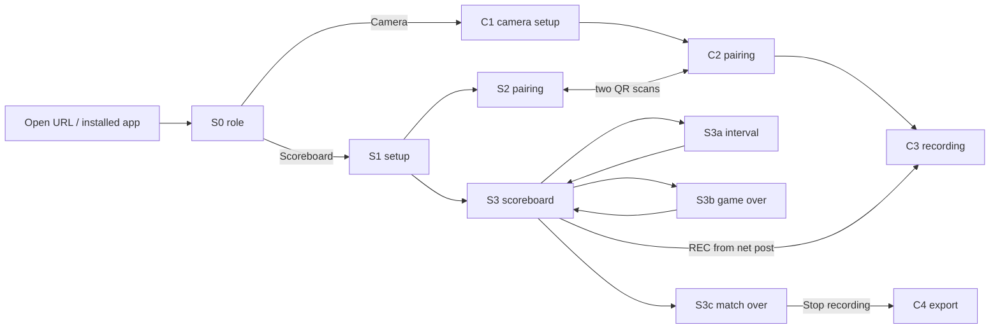
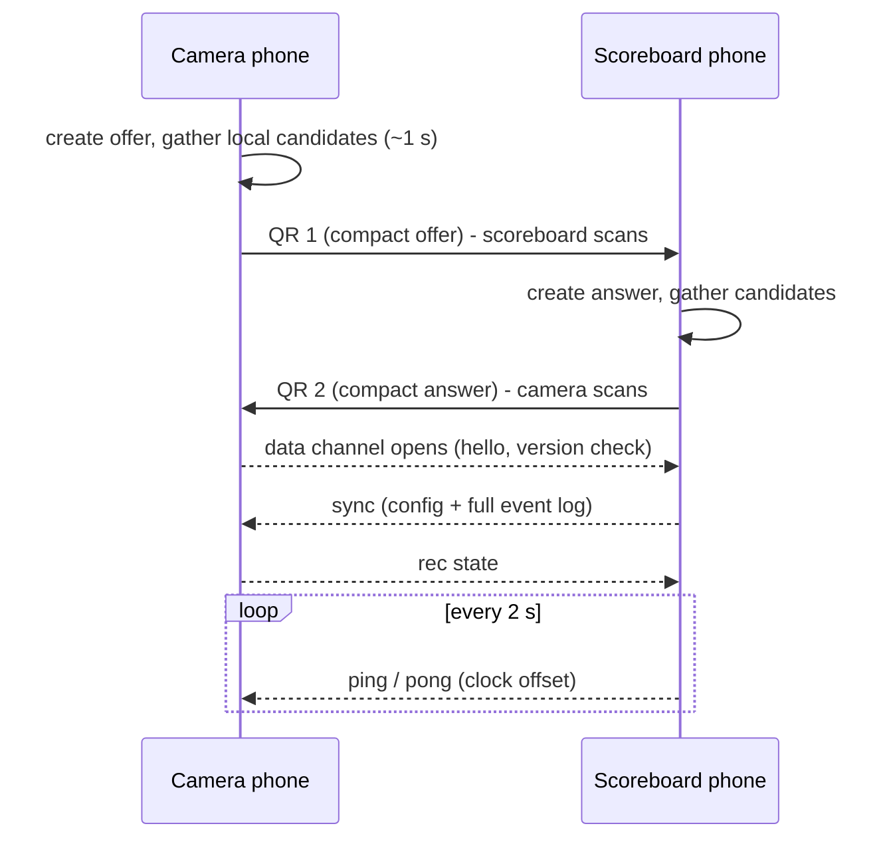
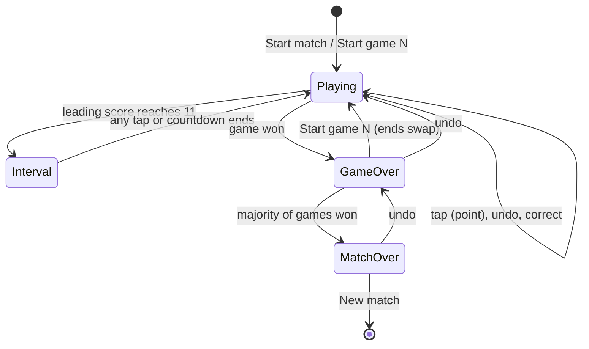

# UX design

How the two phones are used on the court. Requirement ids refer to
[requirements.md](requirements.md); open choices (D1 to D13) live only there.

Both roles run in landscape. Dark background, big type, team colours. Every
screen is designed to be understood by a sweaty player who has never seen the
app, from 6 m away or with one glance at the net post.

## 1. Screen inventory

| Id | Role | Screen | Requirements |
|---|---|---|---|
| S0 | both | Role choice | R-SETUP-1 |
| S1 | scoreboard | Match setup | R-SETUP-2, R-SETUP-3 |
| S2 | scoreboard | Pairing (scan, then show) | R-PAIR-1 |
| S3 | scoreboard | Scoreboard | R-SCORE-*, R-DISP-* |
| S3a | scoreboard | Interval overlay | R-SCORE-4, R-SCORE-5 |
| S3b | scoreboard | Game over / change ends overlay | R-SCORE-2, R-SCORE-5 |
| S3c | scoreboard | Match over overlay | R-SCORE-2 |
| S4 | scoreboard | Correction sheet | R-SCORE-7 |
| S5 | scoreboard | Menu | R-SCORE-7, R-PAIR-6 |
| C1 | camera | Camera setup | R-SETUP-4, R-REC-3, R-REC-4 |
| C2 | camera | Pairing (show, then scan) | R-PAIR-1 |
| C3 | camera | Recording | R-REC-*, R-DISP-9 |
| C4 | camera | Recordings and export | R-REC-6, R-EXP-* |
| E1 | both | Error and reconnect states | R-REC-5, R-DISP-9, N-BROWSER-1 |

### S0 Role choice

```
+---------------------------------------------------------------+
|                    badminton-scoreboard                       |
|                                                               |
|   +-----------------------+     +-----------------------+     |
|   |      SCOREBOARD       |     |        CAMERA         |     |
|   |  at the net post      |     |  at the back corner   |     |
|   +-----------------------+     +-----------------------+     |
|                                                               |
|   Last time: Scoreboard                     Recordings (2) >  |
+---------------------------------------------------------------+
```

Two buttons, each half the screen. The previous role is highlighted. The
"Recordings" link opens C4 on any phone that holds recordings.

### S1 Match setup (scoreboard)

```
+---------------------------------------------------------------+
| <  Match setup                              [ Same as last ]  |
|                                                               |
|   LEFT of this screen              RIGHT of this screen       |
|   Name   [ A           ]           Name   [ B           ]     |
|   Colour (o)(o)(o)(o)              Colour (o)(o)(o)(o)        |
|                                                               |
|   Points to win (11)(15)(21*)   Games (1)(3*)   Interval (on*)|
|   First server  (A*)( B )                                     |
|                                                               |
|   Camera: not paired  [ Pair camera ]        [ START MATCH ]  |
+---------------------------------------------------------------+
```

- "Left" and "right" are literal: the side of this screen as it will sit on
  the post. No court geometry questions.
- "Same as last" fills everything from the previous match and starts. Fresh
  install: names A and B, first two palette colours, 21 / best of 3 / interval
  on, A serves (R-SETUP-3).
- Pairing is optional here and also reachable from the menu (S5), so the
  scoreboard works alone (R-PAIR-3).

### S2 / C2 Pairing

Two scans, no server (D2). The phones are held together for about 20 s.

```
 Camera phone (C2)                      Scoreboard phone (S2)
+------------------------------+       +------------------------------+
| 1. Show this to the          |       | 1. Scan the camera phone     |
|    scoreboard phone          |       |                              |
|         [ QR: offer ]        |  -->  |      [ viewfinder ]          |
|                              |       |                              |
| 2. Now scan the scoreboard   |       | 2. Show this to the camera   |
|      [ viewfinder ]          |  <--  |         [ QR: answer ]       |
|                              |       |                              |
| Paired with "A vs B"  (ok)   |       | Paired, camera ready  (ok)   |
+------------------------------+       +------------------------------+
```

The scoreboard phone opens its camera to scan first; that camera permission is
also what lets iOS expose local-network connection candidates
(technical-design.md §4). Each step has a "Something wrong? Start over" link.

### S3 Scoreboard (main screen)

```
+---------------------------------------------------------------+
| ...   Game 2 - games A 1-0 B          (*) REC 12:34   link ok  |
|                               .                               |
|            A                  .              B                |
|                               .                               |
|                               .                               |
|          20  >                .             16                |
|                               .                               |
|      GAME POINT               .                               |
|                               .                               |
|                      ( <- Undo )                              |
+---------------------------------------------------------------+
   tap anywhere on the left half     tap anywhere on the right half
```

- Left half scores for the team currently on the left of the screen; right
  half for the other (R-DISP-1). The halves carry the team colour as a dim
  tint; the digits are in full team colour (R-DISP-2).
- `>` next to a score is the shuttle (server) marker; a small two-box court
  glyph under it shows the service court (R-DISP-4, D4).
- "GAME POINT" / "MATCH POINT" sit under the digits of the team that has it
  (R-DISP-5).
- Top bar: menu (`...`), game number and games won, camera REC state and
  elapsed time, link chip (R-DISP-9). It is 56 px tall and not part of the
  tap zones.
- Undo pill at bottom centre, 160 × 64 px, in a 72 px band that is not part
  of the tap zones (D6, R-SCORE-6). After an undo it reads "Redo" for 5 s.
- The bottom safe-area strip (iOS home indicator, Android gesture bar) is
  excluded from the zones.

### S3a Interval overlay

```
+---------------------------------------------------------------+
|                                                               |
|                     INTERVAL   0:47                           |
|                     A  11 - 7  B                              |
|            (deciding game)  CHANGE ENDS                       |
|                                                               |
|            [ Resume ]        any tap resumes                  |
+---------------------------------------------------------------+
```

Shown when the leading score first reaches 11 (R-SCORE-4). Any tap dismisses
it and nothing else; the next tap scores. In the deciding game the overlay
also says "change ends" and the halves swap colours when it closes
(R-SCORE-5). It auto-dismisses when the countdown ends.

### S3b Game over / change ends

```
+---------------------------------------------------------------+
|               GAME 1 TO A    21 - 17                          |
|               games  A 1 - 0 B                                |
|               Change ends - A serves first                    |
|               Interval  1:52                                  |
|                                                               |
|   ( <- Undo last point )                 [ START GAME 2 ]     |
+---------------------------------------------------------------+
```

The next game starts only on "Start game N" (an explicit event, see §5),
after which the halves are swapped and the serving marker moves to the game
winner (R-SCORE-2, R-SCORE-5). Undo here reverts the game-winning point.

### S3c Match over

```
+---------------------------------------------------------------+
|                    A WINS  2 - 1                              |
|            21-17   18-21   21-19      48 min                  |
|                                                               |
|   ( <- Undo )     [ Stop recording ]     [ New match ]        |
+---------------------------------------------------------------+
```

"Stop recording" appears only when a camera is paired (D11, R-PAIR-6). "New
match" returns to S1 with the same settings.

### S4 Correction sheet

```
+------------------------------------------+
| Correct score                   [Cancel] |
|   A  [ - ] 15 [ + ]    B  [ - ] 15 [ + ] |
|   Games A [ - ] 1 [ + ]  B [ - ] 0 [ + ] |
|   Server  (A*)( B )      Sides  [ Swap ] |
|                                 [ Apply ]|
+------------------------------------------+
```

Opened by long-pressing a half (that team pre-focused) or from the menu
(R-SCORE-7). Apply writes one `correct` event.

### S5 Menu (`...`)

Correct score · Swap sides · Change server · Start/stop recording (when
paired) · Pair camera / Re-pair · Sound and voice · End match. Each item is a
full-height row, at least 56 px.

### C1 Camera setup

```
+---------------------------------------------------------------+
| <  Camera                                   link: not paired  |
|  +---------------------------------------------------------+  |
|  |                                                         |  |
|  |            live preview        [ A 0 | 0 B ]            |  |
|  |                                                         |  |
|  +---------------------------------------------------------+  |
|  Quality (1080p*)(720p)   Audio (on*)   Mirror overlay (off*) |
|  Storage: 38 min left at 1080p - persisted ok                 |
|          [ Pair with scoreboard ]              ((  REC  ))    |
+---------------------------------------------------------------+
```

- The overlay on the preview is exactly what the burn-in will draw. If the
  team shown on the left of the preview is actually on the right of the frame,
  the user flips "Mirror overlay" once (R-REC-4).
- "Storage: N min left" comes from the storage estimate at the chosen
  quality; below 10 min it turns amber (R-REC-3). "persisted" shows whether
  the browser granted persistent storage (N-STORE-1).
- REC is a 96 px round button. It can also be triggered from the scoreboard
  (D11).

### C3 Recording

```
+---------------------------------------------------------------+
| (*) REC 12:34 - 26 min left            link ok - A 18 - 16 B  |
|  +---------------------------------------------------------+  |
|  |                                                         |  |
|  |      preview (dims after 30 s, tap to brighten)         |  |
|  |      [ A 18 > | 16 B ]   game 2 - games 1-0             |  |
|  +---------------------------------------------------------+  |
|  [ Dim screen ]                           ( hold to STOP )    |
+---------------------------------------------------------------+
```

- Nothing on this screen needs touching during the match (device role table
  in requirements.md). Stop needs a 1 s hold (R-REC-7).
- The preview dims to 20 % after 30 s to save battery; the capture itself is
  unaffected. Any tap brightens it for 30 s.
- The link chip and the last received score sit in the top bar, so a glance
  from the court confirms the camera is still following.

### C4 Recordings and export

```
+---------------------------------------------------------------+
| Recordings                               storage 6.1 / 58 GB  |
|  Today 19:12   A vs B  2-1   48 min   2.1 GB  [Share] [Delete] |
|  Sun 10:05     A vs B  0-2   31 min   1.4 GB  [Share] [Delete] |
|                                                               |
|  Share sends the video and match.json to Photos, AirDrop,     |
|  Files or Drive. Delete asks once.                            |
+---------------------------------------------------------------+
```

Share opens the system share sheet with the segment file(s) and `match.json`
(R-EXP-1, R-EXP-2). If the browser cannot share files, the row shows
"Download" instead. Delete is a two-step confirm (R-EXP-3).

### E1 Error and reconnect states

| State | Where | What the user sees | Way out |
|---|---|---|---|
| Unsupported browser | S0 | Full-screen message naming Safari on iOS 17+/18.4+ and Chrome 126+ (N-BROWSER-1) | Open the right browser |
| Portrait | S3, C3 | "Rotate your phone" screen; state is kept (R-DISP-7) | Rotate |
| Camera permission denied | C1, S2 | Message with the Settings path for this OS | Grant, then retry |
| No OPFS / private browsing | C1 | "Recording needs normal browsing mode" (D10) | Leave private mode |
| Storage low | C1, C3 | Amber "N min left"; at zero: recording stops cleanly, file kept (R-REC-3) | Export and delete |
| Capture interrupted (call, lock, app switch) | C3 | "Recording stopped: camera interrupted. Segment 1 saved (12:34)." Button: "Resume (segment 2)" (R-REC-5) | One tap |
| Link lost | S3, C3 | Chip goes amber after 6 s, red after 30 s; scoreboard keeps scoring; camera keeps recording and freezes its overlay with "link lost" (R-PAIR-3) | Chip tap opens re-pair (two scans); after re-pair the camera receives the full log (R-PAIR-4) |
| Version mismatch | S2, C2 | "Update the app on the other phone, then pair again" (R-PAIR-7) | Reload the other phone |
| Speech unavailable or muted | S3 | One-line banner "Turn off silent mode to hear the score" (assumption to test, see technical-design.md §9) | Flip the switch |

## 2. Flows

### First match, start to export



1. **Install (optional).** Open the Vercel URL in Safari / Chrome, "Add to
   Home Screen". Needed for persistent storage on iOS and Wake Lock in the
   installed app on iOS 18.4+ (N-STORE-1, N-BROWSER-1).
2. **Roles.** Each phone picks its role (S0).
3. **Setup.** Scoreboard phone: names, colours, format, first server, left
   team (S1). Camera phone: quality, audio, check minutes left (C1).
4. **Pair.** Camera phone shows its code, scoreboard scans, scoreboard shows
   its code, camera scans (S2/C2). About 20 s.
5. **Place the phones.** Camera on the tripod, scoreboard on the post. The
   camera phone's preview overlay confirms left/right; flip "mirror" if wrong.
6. **Start.** "Start match" on the scoreboard, then REC from the scoreboard
   menu (or on the camera phone). The scoreboard speaks "Love all, play".
7. **Score.** Winner of each rally taps their half; flash, sound, spoken
   score (R-DISP-3).
8. **Interval at 11, change ends in game 3** (S3a). **Game over** (S3b):
   "Start game 2" when the players are ready.
9. **Match over** (S3c): stop the recording from the scoreboard.
10. **Export** (C4): share to Photos/AirDrop/Files. Delete when done.

### Pairing handshake



### Scoring loop and rule prompts



### Disconnect and reconnect

1. Pings stop arriving; after 6 s both chips show amber "link lost", after
   30 s red.
2. The scoreboard keeps scoring and logging (R-PAIR-3). The camera keeps
   recording; its overlay freezes with "link lost".
3. The user re-pairs when convenient (two scans). The camera receives the full
   log and computes recording-relative times for the missed events from the
   clock offset (R-PAIR-4, R-PAIR-5). Nothing about the video changes.

### Camera interruption

1. The camera track ends (call, screen lock, app switch).
2. The current segment is finalised and listed; C3 shows the interruption
   message (E1).
3. "Resume" starts segment 2 of the same match. The export bundle lists both
   segments with their start times (technical-design.md §8).

## 3. Tap zones and touch handling

- Zones: the two halves of the screen, each 50 % wide minus a 24 px inset at
  the outer edge, from below the 56 px top bar to above the 72 px bottom band
  and the safe-area strip. Minimum zone area on
  an iPhone 15-sized screen is about 400 × 250 px, far above any touch-target
  guideline (R-DISP-1).
- A **point** is one pointer, down-to-up in 30 to 400 ms, moved less than
  24 px, with no other pointer active, and at least 800 ms after the previous
  point (R-DISP-6).
- A **long-press** (600 ms or more, little movement) on a half opens the
  correction sheet for that team (S4).
- A **swipe down** (80 px or more within 500 ms, anywhere) is Undo (D6).
- Touches that start in the top bar or bottom band belong to those controls.
- Wet-finger reality: a wet screen produces phantom short touches and
  multi-touch. The 30 ms floor and the single-pointer rule drop most of them;
  the 800 ms refractory period makes the rest cost at most one undo.
- iOS: the system edge gestures (home indicator, back swipe from the left
  edge) cannot be disabled by a web app. The zones keep a 24 px inset from the
  left and right edges and the safe-area inset at the bottom. For a nervous
  match, iOS Guided Access or Android screen pinning locks the phone to the
  app; this is a tip in the setup screen, not a requirement.

## 4. Feedback

| Channel | On a point | Other moments |
|---|---|---|
| Visual | The scoring half flashes to full team colour for 250 ms; the digit scales up 15 % for 150 ms; the shuttle marker moves | Interval, game and match overlays; ends-swap slide animation (500 ms) |
| Sound | Short click (Web Audio buffer, ready before the match) | "Game", "Interval", "Change ends" chimes |
| Voice (D5) | "Twelve, nine" (server's score first); "service over" is not spoken, the marker shows it | "Game point", "Match point", "Game 1 to A, 21-17", "Love all, play" |
| Haptic | 40 ms vibration on Android; none on iOS (no Vibration API in Safari, technical-design.md §9) | None |

Audio on iOS only plays after a user gesture; the "Start match" tap unlocks
audio and speaks "Love all, play", so the user hears immediately whether the
volume and the silent switch are right. Voice and sounds have independent
toggles in the menu.

## 5. Design rationale and alternatives

Departures from the starting point described in the brief, and why.

- **Undo is a button, with swipe as a shortcut (D6).** The starting point was
  swipe-down only. A swipe on a wet screen often registers as a tap, which
  would *score* instead of undo, the worst possible failure. The button sits in
  a band that cannot score. Alternative considered: a two-finger tap, rejected
  as undiscoverable.
- **Correction is long-press or menu, not "tap the digits".** The digits sit
  inside the tap zone; a tap there must score, otherwise players learn that
  "the middle does something else" and hesitate. Alternative considered: a
  small pencil button next to each score, rejected because it adds a target
  that can be hit by mistake.
- **Explicit "Start game N".** Auto-starting the next game on the first tap
  was considered. The first tap after a change of ends is exactly when players
  tap the wrong half, and the burn-in needs a clean "game 2 started at" time.
  One deliberate tap costs nothing.
- **The interval overlay swallows exactly one tap.** A less intrusive chip was
  considered, but the deciding-game ends change has to be announced in a way
  nobody can miss, and the overlay doubles as the countdown.
- **REC from the scoreboard phone (D11).** Not in the starting point. The
  camera stands in the far corner; walking there to start and stop is the
  single most annoying step in the scenario. The message is one command over
  the channel that already exists.
- **"Mirror overlay" toggle instead of asking where the camera stands.** The
  user sees the preview and flips a switch if it looks wrong. Any question
  about court geometry would be answered wrong half the time.
- **No portrait layout.** iOS cannot lock orientation; building and testing a
  second layout for a state that should never occur on the post is wasted
  effort. A "rotate" screen is enough. Android locks to landscape.
- **Setup before pairing, pairing optional.** The scoreboard must be usable
  alone (R-PAIR-3), and pairing is the step most likely to fail on an unknown
  Wi-Fi. Putting it after setup means a failed pairing still leaves a working
  scoreboard.
- **Team-level server only (D4).** Per-player service tracking in doubles
  needs the players' court positions after every rally. It would require
  tapping *who* won the rally, which turns a one-tap action into a decision.
- **Two scans instead of one.** One scan is possible only with a server (D2).
  The second scan costs about 10 s once per session; the server would cost
  internet on the court and a piece of infrastructure to run.
- **Spoken score instead of a bigger screen.** A phone at the net post is
  small. Speech lets the player walk back without reading. "Service over" is
  deliberately not spoken; the marker shows it, and short calls are heard
  better in a gym.
